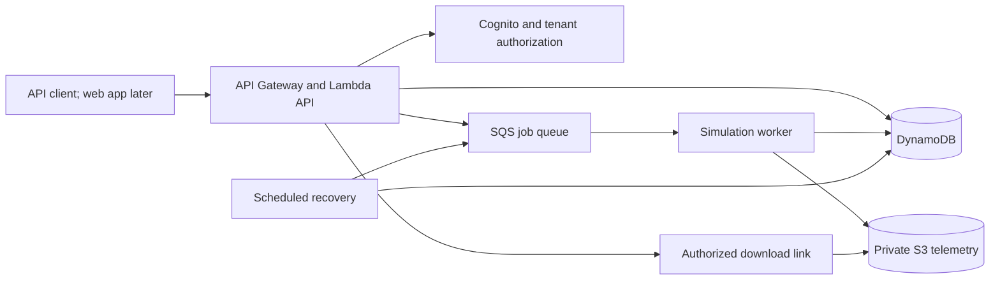

# RobotOps

> [!WARNING]
> RobotOps is in heavy development. Interfaces and setup may change, and things
> may break. The roadmap is only partly implemented; see [Current state](#current-state)
> for what works today.

RobotOps is a multi-tenant cloud platform for managing simulated robots, running deterministic
simulation workloads, and collecting telemetry datasets. It is a learning and
portfolio project around cloud infrastructure, distributed systems, and robotics data.

Start with [Getting started with RobotOps](docs/guides/getting-started.md) to try
what works today and find a way to contribute. Read [the storage guide](docs/guides/storage.md) for an introduction to database records and result files. Use the
[documentation map](docs/README.md) for technical references and decisions.

## Current state

The repository provides a development foundation: local checks, boundary tests,
a Lambda bundling example, [shared R1 contracts](packages/contracts/README.md), [storage resource synthesis](docs/reference/data-model.md), and
[authorization services with local test identity](docs/guides/authorization.md). Robot registration, simulation services, login,
and cloud deployment are planned. The [roadmap](https://github.com/gleniosp/robotops/issues/2)
owns delivery order and release criteria; [milestones](https://github.com/gleniosp/robotops/milestones)
track progress.

## Planned system

The first release is an authenticated API that keeps each tenant's robots,
simulation runs, and telemetry separate and checks access through tenant membership.
It supports registering robots, submitting simulations, monitoring runs, and
downloading generated telemetry. A web
application and typed SDK follow. The
[architecture plan](https://github.com/gleniosp/robotops/issues/1) defines the design.

Deployment targets Europe (Frankfurt), `eu-central-1`. Simulations use a bounded,
deterministic software model. Physical robot control, physics engines, motion
planning, and safety-critical operation are outside the initial scope.

## Community and license

Read [CONTRIBUTING.md](CONTRIBUTING.md) to work on an issue and prepare a contribution.

Read the [security policy](SECURITY.md) before reporting a vulnerability and the
[code of conduct](CODE_OF_CONDUCT.md) for participation expectations.

Copyright 2026 RobotOps contributors. Original code, documentation, and
configuration are licensed under [Apache-2.0](LICENSE), unless a file says
otherwise. Dependencies retain their own licenses.
