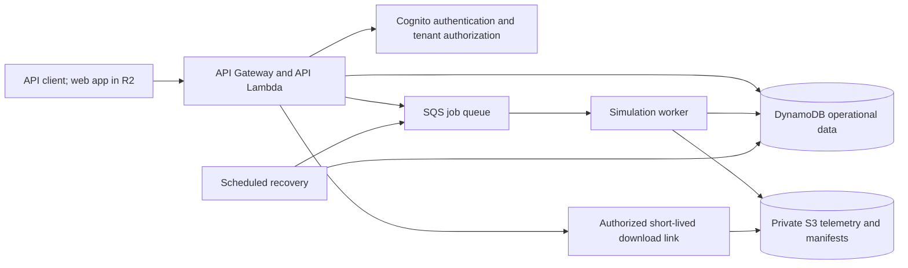

# RobotOps

RobotOps is a cloud platform for managing simulated robots, running deterministic simulation workloads, and collecting telemetry datasets. It is designed as a learning and portfolio project around cloud infrastructure, distributed systems, and robotics data.

The first release will provide an authenticated API for registering robots, submitting simulations, monitoring their runs, and downloading generated telemetry. Simulations use a bounded, deterministic software model; the initial product does not control physical robots.

## Project status

RobotOps is in the planning stage. The implementation backlog, architecture decisions, release gates, and delivery estimates are tracked in [GitHub Issues](https://github.com/gleniosp/robotops/issues) and [milestones](https://github.com/gleniosp/robotops/milestones). Application code and a runnable local environment are not available yet.

The planned delivery gates are:

- **R1 — Minimum Deployable Slice:** A secure simulation API deployed to AWS Dev, including asynchronous execution and private telemetry artifacts.
- **R2 — Minimum Viable Product:** A React application, typed TypeScript SDK, production deployment, and essential operational safeguards.
- **R3 — Production hardening:** Measured security, reliability, performance, and recovery validation.

See [the architecture planning issue](https://github.com/gleniosp/robotops/issues/1) and [the delivery roadmap](https://github.com/gleniosp/robotops/issues/2) for the accepted design, dependencies, estimates, and release criteria.

## Planned architecture

The initial system is a TypeScript modular monolith using Effect v4. AWS CDK will define the infrastructure. An API Gateway and Lambda API will authenticate users with Amazon Cognito and authorize access using server-side tenant membership. DynamoDB will store operational records, Amazon SQS will dispatch simulation jobs to workers, and private Amazon S3 storage will hold telemetry artifacts and dataset manifests.

The deployment region is **Europe (Frankfurt), `eu-central-1`**. The local development plan uses Docker Compose and MiniStack where compatible, with local handler-based workflows for unsupported emulator behavior. Real AWS Dev checks remain the deployment acceptance gate.

## Planned technology

- TypeScript, Node.js 24, pnpm workspaces, and Effect v4
- Project-local Vite+ for Vite, Vitest, Oxlint, and Oxfmt tooling
- AWS CDK, API Gateway, Lambda, Cognito, DynamoDB, SQS, S3, and CloudWatch
- React and Vite+ for the R2 web application
- GitHub Actions with AWS OIDC for deployment

Exact versions and commands will be recorded during implementation. There is no runnable development quickstart yet.

## Using and contributing

User guides, contributor instructions, architecture explanations, diagrams, and a shared glossary will be added as the corresponding capabilities are implemented. The project will keep a root README and focused documentation in relevant folders. Scoped `AGENTS.md` files will contain concise local guidance and link to canonical documentation.

Maintainer-led issue work follows the [working agreement](https://github.com/gleniosp/robotops/issues/1), including issue-number branch names, prerequisite checks, validation, review, and pull request handling. Public contribution guidance will be added before external contributions are invited.

## Scope boundaries

The initial releases focus on simulation orchestration and telemetry. Physical robot connectivity, physics engines, motion planning, safety-critical control, Kubernetes, ML training, complex billing, and large-scale streaming analytics are future work.
