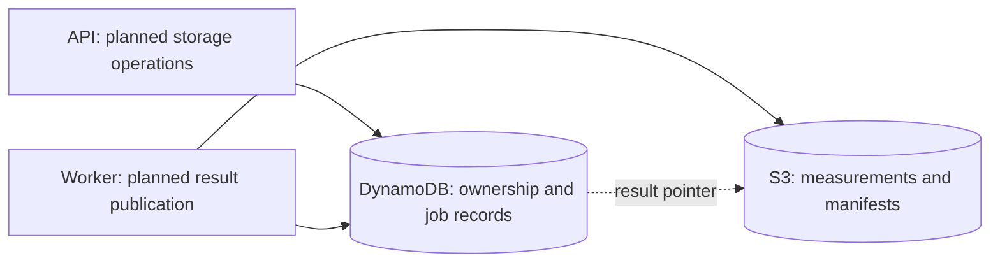

# Understand RobotOps storage

RobotOps needs to remember which robots belong to a tenant, what simulation work
is pending, and where a finished simulation's measurements can be downloaded.
This guide explains how those pieces fit together and how to inspect the storage
foundation locally.

Today, the project can generate the AWS storage resource definitions, build
validated database keys and decode versioned records. It does not yet save robots,
execute submission transactions or upload simulation results. The examples below
explain the accepted design for those future workflows.

## Two places for two kinds of data

Think of DynamoDB as a catalogue and S3 as a filing cabinet.

DynamoDB stores small records that the application needs to look up or change
quickly: tenants, memberships, robots, simulation runs, retry responses and work
waiting to be sent to a worker. S3 stores files: the measurements generated by a
simulation and a manifest describing those measurements.

A run's database record will point to its result file. It will not contain every
measurement. Keeping the catalogue small makes status updates and permission
checks practical even when a simulation produces many measurements.



The diagram shows the intended runtime flow. The database and bucket definitions
exist today; the API and worker storage operations are still planned.

## Find a record by its address

DynamoDB records are called items. Each item has a two-part address: a partition
key (`PK`) and a sort key (`SK`). A partition groups related items; a sort key
identifies an item within that group and gives it an order.

For example, imagine a tenant whose identifier is `01ARZ3NDEKTSV4RRFFQ69G5FAV`.
Its robot records share this partition:

```text
PK = TENANT#01ARZ3NDEKTSV4RRFFQ69G5FAV
```

One robot has a sort key such as:

```text
SK = ROBOT#01ARZ3NDEKTSV4RRFFQ69G5FAW
```

Knowing both parts lets the application fetch that robot directly. Asking for
items in the same partition whose sort keys begin with `ROBOT#` lists that
tenant's robots. Run records use `RUN#` instead, so the same table can hold
several kinds of records without mixing their lists.

The prefixes are labels chosen by this project, not special DynamoDB commands.
The [complete key table](../reference/data-model.md#keys-and-reads) explains the
addresses for every record kind. Trusted application code builds these addresses;
a client does not choose a raw database key.

## An address does not grant access

A [tenant](../reference/glossary.md) is a group whose resources are kept separate
from other groups. Selecting a tenant in an API request does not prove that the
caller belongs to it.

The intended request flow first verifies the caller's identity, reads the active
tenant and membership, and checks the caller's role. Only then does it use the
authorized tenant to build a robot or run key. Those permission reads are strong:
they request the latest committed value rather than a possibly older copy.

Storage encryption and private buckets protect data at the infrastructure level.
Application authorization still decides which person may use which resource.
See the [authorization guide](authorization.md) for that boundary.

## Follow a simulation through storage

The following sequence is planned; it explains why the foundation has more than
just robot and run records.

1. **Accept the request once.** The client supplies an idempotency key, a label
   identifying an intended submission. The application records the request's
   fingerprint and original response. A retry with the same meaning can return
   that response; reusing the label for different work returns a conflict.
2. **Save the run and the obligation to dispatch it together.** A database
   transaction groups changes so they either all commit or none do. It creates
   the run, retry record and dispatch record while checking that the robot is
   active. This avoids accepting a run without remembering that it needs work.
3. **Send work to the queue.** Sending a queue message cannot join that database
   transaction. The dispatch record survives if sending fails, allowing recovery
   to retry later.
4. **Run the simulation.** A worker claims a time-limited lease. A fence is an
   increasing counter checked during updates, so a worker with an expired
   claim cannot overwrite a newer worker's result.
5. **Publish the result.** The worker uploads attempt-specific files to S3, then
   conditionally saves the winning file pointer and removes the dispatch record.
   Uploading a file alone does not make it the authoritative result.
6. **Download with permission.** The API checks access before issuing a temporary
   download link. The bucket itself remains private.

Idempotency records expire for replay after 24 hours. DynamoDB's time to live
(TTL) feature eventually deletes expired items, but deletion is not immediate.
The application must check the expiry itself before deciding whether to replay.

## Recover work without searching the whole table

Recovery needs a different question from normal API reads: “Which jobs need
attention now, across all tenants?” Reading the entire table repeatedly would
be wasteful. The `WorkDue` global secondary index is a second lookup structure
containing only dispatch records with due-work attributes. This is called a
sparse index because other items do not appear in it.

Each indexed record goes into one of four buckets selected by hashing its run
identifier. Within a bucket, the sort key begins with its due time. A recovery
process can ask each bucket for work due before the current time, using bounded
pages rather than a full table scan.

The index can lag behind the table. A returned entry is therefore a candidate,
not proof that the job still needs work. Recovery must re-read the authoritative
records and conditionally claim them. A completed job may briefly remain visible
in the index without being safe to execute again.

## Keep old data understandable

A storage envelope has a `recordVersion`, a record kind such as `robot`, and its
payload. The version tells the reader how to interpret the saved data. Today only
version `"1"` exists. Unsupported versions produce an explicit error; missing or
malformed fields fail validation.

This is separate from the public API version and telemetry file version. Changing
an HTTP response does not automatically change how an old database item should
be read. Preserved JSON fixtures in the storage tests check that the
current reader can still understand the initial record shapes.

Future changes must introduce readers that understand both versions before new
writers start saving the new format. Rolling back must preserve the ability to
read records already written. See [schema evolution](schema-evolution.md) before
changing a persisted shape.

## Inspect the foundation locally

Complete the [development setup](getting-started.md), then run from the repository root:

```sh
pnpm test
pnpm run toolchain:bundle
```

The tests include key validation, historical record decoding and assertions about
the generated AWS resources. Synthesis writes `.toolchain-out/template.json`
and a CDK assembly. It does not contact AWS to create a database or bucket.
Inspect the template for `AWS::DynamoDB::Table`, its `WorkDue` index and TTL
attribute, and `AWS::S3::Bucket` with its encryption and public-access settings.

Start with [the resource construct](../../infra/cdk/src/storage.ts) to change
infrastructure, or [the storage model](../../apps/api/src/storage/model.ts) to
understand keys and decoding. The storage tests cover resource assertions and model checks; see the
[testing guide](testing.md) for their location and how to run them.

## Understand what survives cleanup

The construct retains resources by default and protects the table from deletion.
The local synthesis fixture explicitly selects disposable Dev storage. That
choice controls generated deletion policies; it does not delete anything locally
or deploy a disposable environment.

There is no automatic bucket-emptying handler. A deployed Dev bucket would need
explicit cleanup before destruction. There is also no lifecycle rule that
silently expires simulation files. Production backup, versioning and recovery
work is still scheduled separately; retention alone is not a backup strategy.

Use the [data model reference](../reference/data-model.md) for exact limits,
transaction rules and retention policy, and the [storage decision](../adr/04-operational-storage.md)
for the reasons behind the design.
